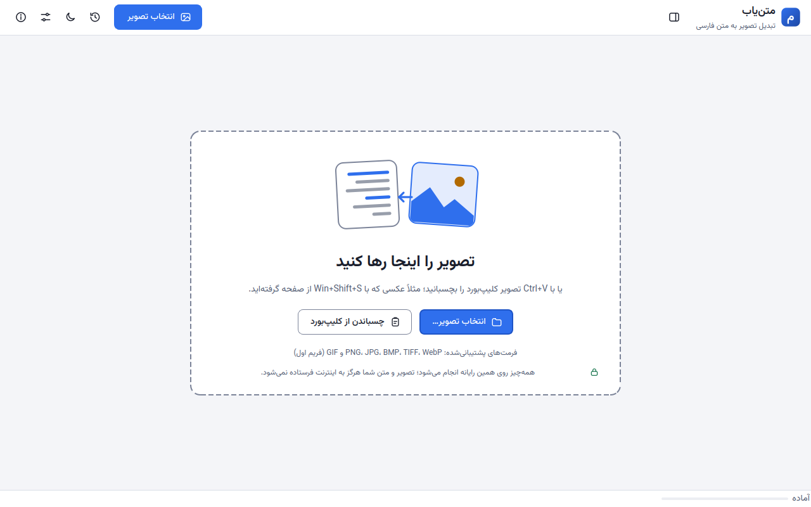
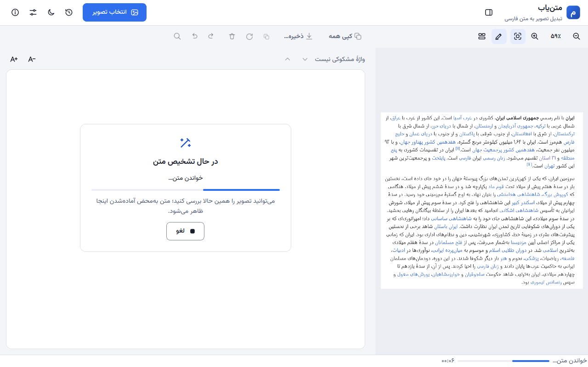
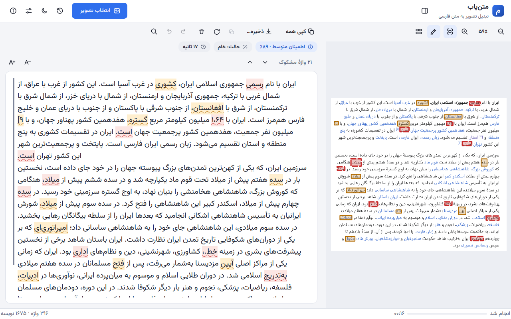
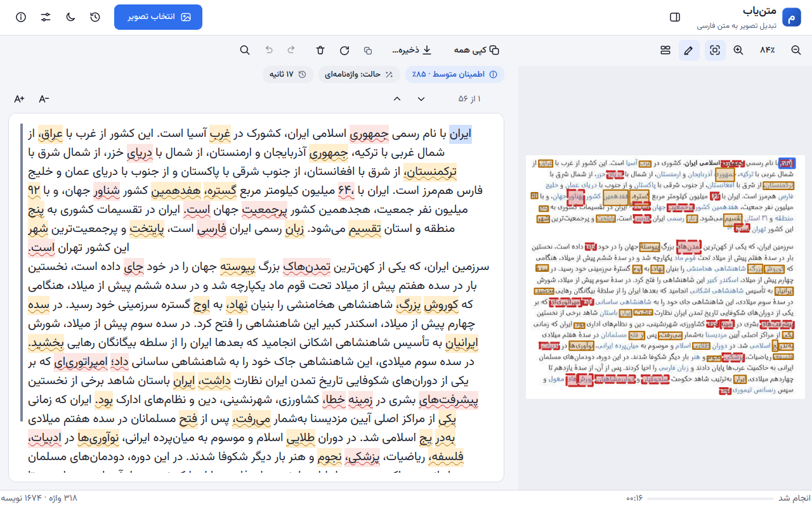
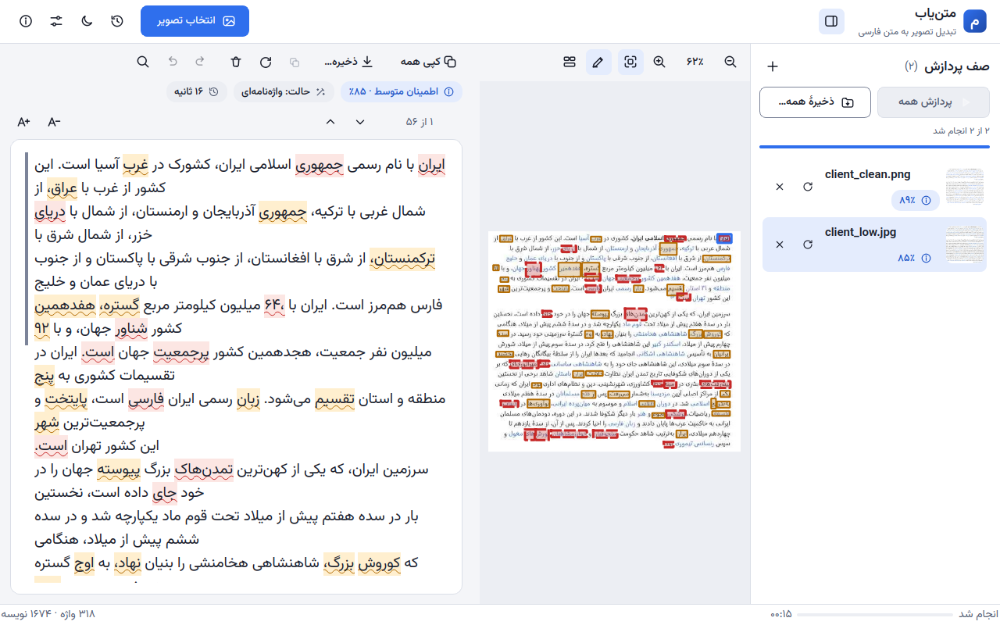
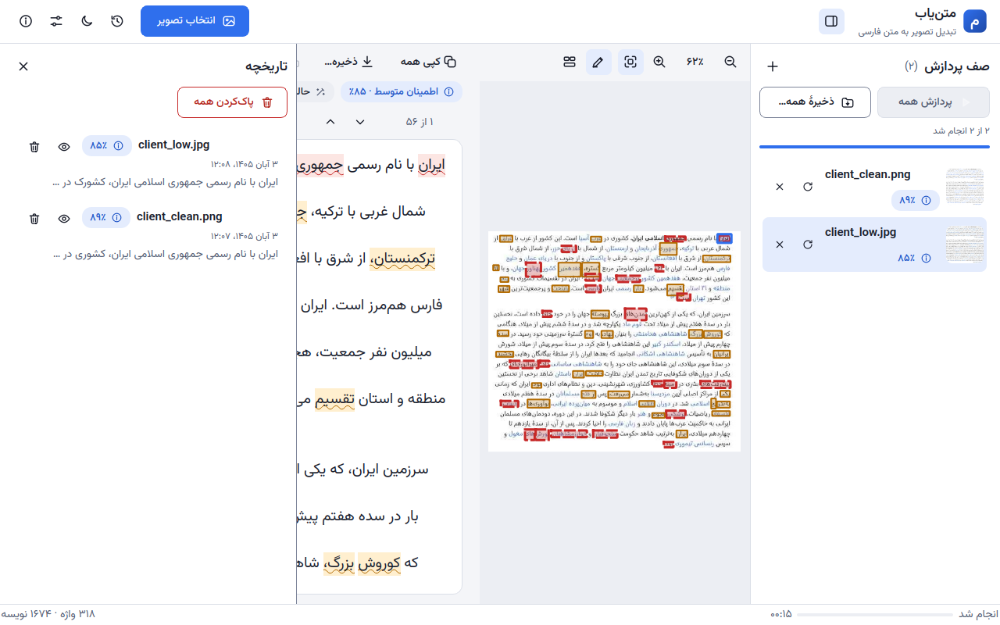
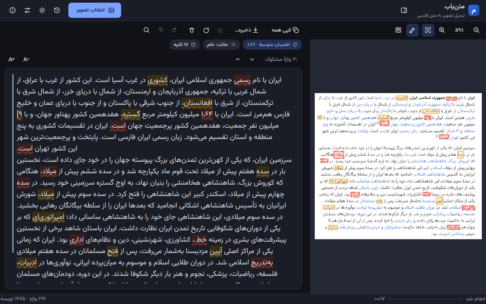
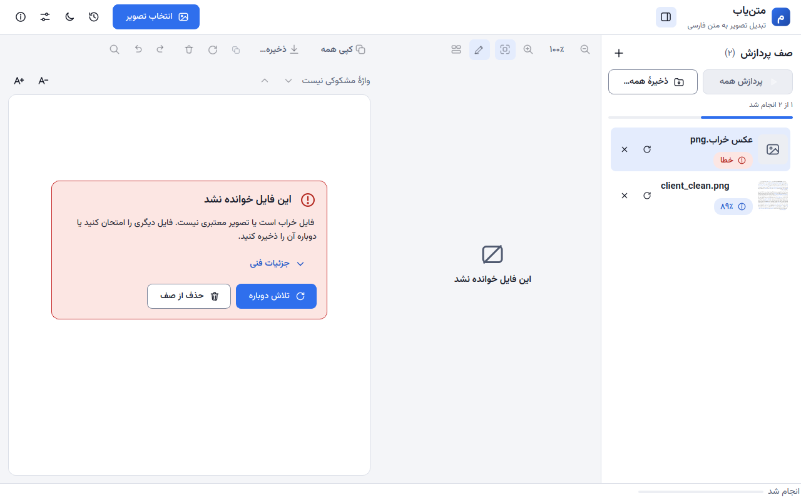

# راهنمای کاربر متن‌یاب (MatnYab)

متن‌یاب برنامه‌ای رومیزی برای ویندوز است که متن فارسی را از روی تصویر (عکس، اسکرین‌شات، اسکن) به متن قابل‌ویرایش تبدیل می‌کند.
**همه‌چیز روی رایانهٔ خودتان انجام می‌شود؛ تصویر و متن شما هرگز به اینترنت فرستاده نمی‌شود.**

## ۱. نصب و اجرا

- **نصب‌کننده:** فایل `MatnYab-Setup-<نسخه>.exe` را اجرا کنید و مراحل را دنبال کنید (به‌صورت پیش‌فرض فقط برای کاربر فعلی نصب می‌شود).
- **نسخهٔ قابل‌حمل:** فایل `MatnYab-<نسخه>-portable.zip` را باز کنید و `MatnYab\MatnYab.exe` را اجرا کنید؛ نصب لازم نیست.
- **هشدار ویندوز (SmartScreen):** فایل‌ها هنوز امضای دیجیتال ندارند. اگر پیام «Windows protected your PC» دیدید، روی «More info» و سپس «Run anyway» بزنید.

## ۲. شروع سریع

یکی از این راه‌ها را بروید:

1. تصویر را روی پنجرهٔ برنامه **بکشید و رها کنید** (یک یا چند تصویر، یا یک پوشه).
2. روی **«انتخاب تصویر…»** بزنید (یا `Ctrl+O`). برای انتخاب یک پوشهٔ کامل `Ctrl+Shift+O`.
3. تصویر را کپی کنید (مثلاً با `Win+Shift+S` از صفحه عکس بگیرید) و در برنامه **«چسباندن از کلیپ‌بورد»** یا `Ctrl+V` را بزنید.

فرمت‌های پشتیبانی‌شده: PNG، JPG، BMP، TIFF، WebP و GIF (فریم اول).

بلافاصله پردازش شروع می‌شود. نوار پیشرفت و مرحلهٔ کار پایین پنجره دیده می‌شود. برای توقف، **«لغو»** یا `Esc` را بزنید.

یک تصویر استاندارد معمولاً در حدود ۱۰ ثانیه آماده می‌شود. زمان به قدرت پردازندهٔ رایانه و تعداد خط‌های متن بستگی دارد؛ صفحه‌های خیلی بزرگ (مثلاً ۶۰۰۰×۴۰۰۰ پیکسل) چند ده ثانیه طول می‌کشند و برنامه در این مدت پاسخگو می‌ماند.

## ۳. خواندن نتیجه

پنجره دو بخش دارد: **تصویر** (سمت راست) و **متن** (سمت چپ).

- بالای متن، سه نشانه می‌بینید: **میزان اطمینان** (میانگین)، **حالت** پردازش و **زمان** پردازش.
- واژه‌هایی که برنامه دربارهٔ آن‌ها مطمئن نیست در متن و روی تصویر **علامت‌گذاری** می‌شوند:
  **زرد** = مشکوک، **قرمز** = بسیار مشکوک. تعداد آن‌ها در بالای متن نوشته شده است («۲۱ واژهٔ مشکوک»).
- با `F3` به واژهٔ مشکوک بعدی و با `Shift+F3` به قبلی بروید. با کلیک روی یک واژه در تصویر، همان واژه در متن انتخاب می‌شود.
- متن را می‌توانید مستقیماً ویرایش کنید؛ علامت واژه‌ای که ویرایش کنید دیگر نشان داده نمی‌شود. جست‌وجو با `Ctrl+F`.
- زوم تصویر: `Ctrl+=` و `Ctrl+-`، اندازهٔ واقعی `Ctrl+1`، متناسب با پنجره `Ctrl+0` (یا `Ctrl` + چرخ ماوس).
- اندازهٔ قلم متن با دکمه‌های **A+** و **A−** تغییر می‌کند.

### تصویر کم‌کیفیت

برای عکس‌های کم‌کیفیت، برنامه خودش حالت **واژه‌نامه‌ای** را انتخاب می‌کند که واژه‌ها را با فرهنگ لغت فارسی اصلاح می‌کند. واژه‌های مشکوک بیشتر می‌شوند؛ آن‌ها را با `F3` مرور و در صورت نیاز اصلاح کنید.

### حالت‌های پردازش

| حالت | معنی |
|---|---|
| خودکار | برنامه برای هر تصویر بهترین حالت را انتخاب می‌کند (پیش‌فرض). |
| خام | خروجی مستقیم موتور تشخیص، بدون اصلاح؛ برای تصویرهای تمیز. |
| واژه‌نامه‌ای | واژه‌ها با فرهنگ لغت اصلاح می‌شوند؛ برای تصویرهای کم‌کیفیت. |

برای پردازش دوبارهٔ همان تصویر با حالت دیگر، دکمهٔ **اجرای دوباره** (نماد چرخش بالای متن) را بزنید؛ ویرایش‌های شما با نتیجهٔ تازه جایگزین می‌شود و پیش از آن تأیید می‌گیرد. نشانه‌های ارجاع مثل `[۱۲]` به‌طور خودکار حذف می‌شوند.

## ۴. چند تصویر: صف پردازش

وقتی بیش از یک تصویر اضافه کنید، **صف پردازش** باز می‌شود (`Ctrl+B` برای نمایش/پنهان‌کردن). تصویرها یکی‌یکی پردازش می‌شوند.

- روی هر تصویر کلیک کنید تا نتیجه‌اش دیده شود. درصد کنار هر تصویر میزان اطمینان است.
- **×** تصویر را از صف برمی‌دارد، نماد چرخش آن را دوباره پردازش می‌کند.
- **«ذخیرهٔ همه…»** نتیجهٔ همهٔ تصویرهای پایان‌یافته را در یک پوشه به‌صورت فایل متنی (با نام همان تصویر) ذخیره می‌کند. اگر نامی تکراری باشد، شمارهٔ `(2)` به آن افزوده می‌شود و فایل قبلی بازنویسی نمی‌شود.
- **«پردازش همه»** (`Ctrl+Enter`) تصویرهایی را که هنوز شروع نشده‌اند به پردازش می‌فرستد.

## ۵. کپی و ذخیره

- **«کپی همه»** (`Ctrl+Shift+C`): کل متن در کلیپ‌بورد. برای کپی بخشی از متن آن را انتخاب و `Ctrl+C` بزنید.
- **«ذخیره…»** (`Ctrl+S`): فایل **TXT** یا **DOCX** (ورد). فایل TXT با کدگذاری UTF-8 ذخیره می‌شود و در نوت‌پد درست باز می‌شود. در فایل DOCX هر بند از راست به چپ است.
- نام فایل و پوشه می‌تواند فارسی و دارای فاصله باشد.
- اگر پوشه قفل یا فقط‌خواندنی باشد، پیام «ذخیره انجام نشد…» می‌آید و متن شما از دست نمی‌رود؛ پوشهٔ دیگری انتخاب کنید.

## ۶. تاریخچه

هر پردازش موفق خودکار در **تاریخچه** (`Ctrl+H`) ثبت می‌شود (حداکثر ۲۰۰ مورد). با نماد چشم متن قبلی باز می‌شود، با نماد سطل زباله آن مورد و با «پاک‌کردن همه» کل تاریخچه حذف می‌شود.

## ۷. تنظیمات و پوستهٔ تاریک

با `Ctrl+,` تنظیمات باز می‌شود:

- **پوسته:** همسو با سیستم، روشن یا تاریک (میان‌بر `Ctrl+Shift+T`).
- **حالت پردازش** پیش‌فرض.
- **شکل ارقام** هنگام کپی و ذخیره: بدون تغییر، فارسی (۱۲۳) یا انگلیسی (123).
- **یکسان‌سازی حرف‌های عربی** (ي ← ی، ك ← ک) هنگام کپی و ذخیره؛ متن داخل ویرایشگر دست‌نخورده می‌ماند.
- اندازهٔ قلم ویرایشگر.

برنامه با نمایشگرهای پرتراکم و بزرگ‌نمایی ۱۲۵٪، ۱۵۰٪ و ۲۰۰٪ ویندوز کار می‌کند.

## ۸. میان‌برهای صفحه‌کلید

لیست کامل با `F1` یا `Ctrl+/` در خود برنامه باز می‌شود. مهم‌ترین‌ها:

| کار | میان‌بر |
|---|---|
| انتخاب تصویر / پوشه | `Ctrl+O` / `Ctrl+Shift+O` |
| چسباندن تصویر | `Ctrl+V` |
| ذخیره | `Ctrl+S` |
| کپی همهٔ متن | `Ctrl+Shift+C` |
| جست‌وجو | `Ctrl+F` |
| واژهٔ مشکوک بعدی / قبلی | `F3` / `Shift+F3` |
| لغو پردازش | `Esc` |
| صف / تاریخچه / تنظیمات | `Ctrl+B` / `Ctrl+H` / `Ctrl+,` |

## ۹. عیب‌یابی

| پیام یا حالت | علت و راه‌حل |
|---|---|
| «این فایل خوانده نشد» | فایل خراب است یا تصویر معتبر نیست. فایل دیگری را امتحان کنید یا دوباره ذخیره‌اش کنید. بقیهٔ تصویرهای صف ادامه پیدا می‌کنند. |
| «موتور تشخیص متن آماده نیست» | موتور بارگذاری نشد. برنامه را دوباره باز کنید یا دوباره نصب کنید. با «جزئیات فنی» دلیل دقیق دیده می‌شود. |
| پیام دربارهٔ تصویر خیلی بزرگ | تصویرهای بزرگ‌تر از ۱۰۰ مگاپیکسل پیش از شروع تأیید می‌خواهند؛ پردازششان زمان‌بر است. |
| متن خالی | تصویر متنی ندارد یا بسیار کوچک/بی‌کنتراست است. تصویر بزرگ‌تر یا واضح‌تر امتحان کنید. |
| دقت پایین | تصویر با بیشترین کیفیت ممکن (بدون فشرده‌سازی زیاد) بگیرید یا حالت «واژه‌نامه‌ای» را امتحان کنید؛ متن را با `F3` مرور کنید. |

تنظیمات، تاریخچه و پرونده گزارش خطا (`matnyab.log`) در پوشهٔ `%APPDATA%\MatnYab` ذخیره می‌شوند. برای گزارش مشکل، این پرونده را پیوست کنید.
